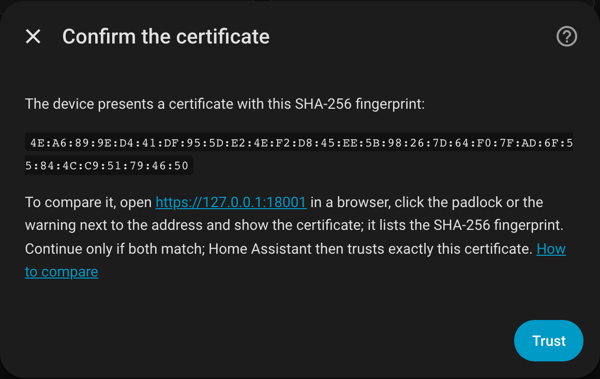
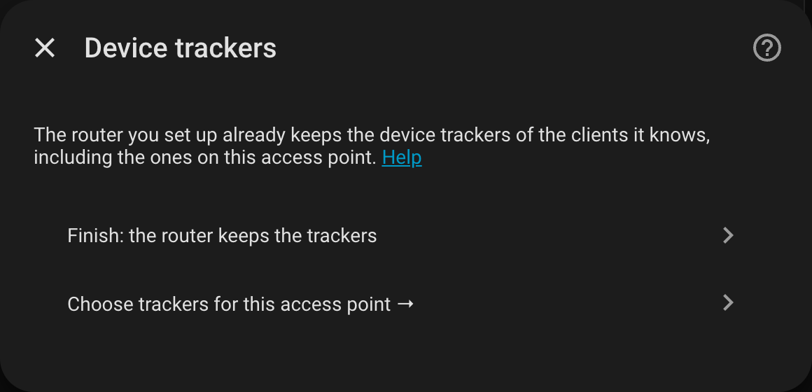
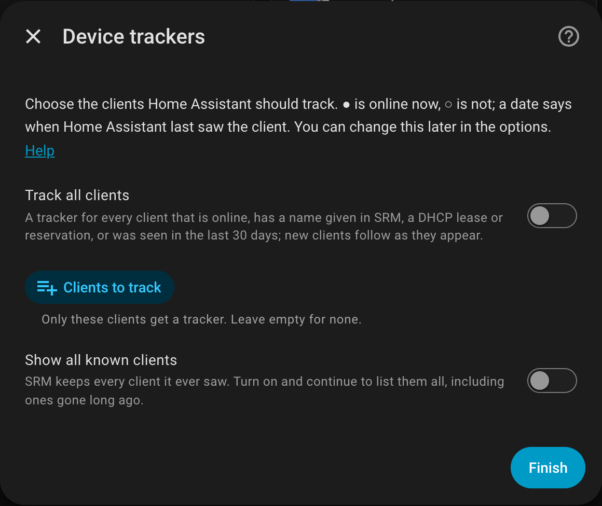

# Configuration

## Adding a device

Add the integration once for every Synology router and every access point. Each becomes its own
device in Home Assistant, named after its model (with the end of the serial number when two of the
same model are set up). Their client lists are combined automatically, so a client on an access
point is shown there.

| Field | Meaning |
| --- | --- |
| Host | Address or host name of the router or access point. |
| Port | Leave empty for SRM's default: 8001 for HTTPS, 8000 for HTTP. |
| Use HTTPS | Recommended: the password travels encrypted. |
| Check the certificate | Shows the certificate's fingerprint for you to confirm, then trusts exactly that certificate (see below). Turn off only if you accept that anyone in your network could read the password. |

Each device is recognised by its serial number. Whether it runs as router or as access point is
read at every start, so switching the operation mode in SRM needs no reconfiguration.

## Certificate

SRM uses a certificate that browsers do not trust by default, so Home Assistant shows its SHA-256
fingerprint once and then trusts exactly that certificate. To check that you are talking to your
device and not to something in between:

1. Open the address shown in the dialog (for example `https://192.168.1.1:8001`) in a browser.
2. Click the padlock or the warning next to the address and open the certificate details.
3. Compare the SHA-256 fingerprint there with the one in the dialog. Both list the same pairs of
   characters; continue only if they match.

When the certificate changes later, for example after a renewal, Home Assistant asks again and
shows the new fingerprint.

{ width="560" }

## Account

Use an SRM **administrator** account (SRM's Web API answers nothing else) without two-factor
authentication; Home Assistant cannot enter codes unattended. A dedicated account for Home
Assistant is best: it shows up on its own in SRM's logs, and you can change its password without
touching anything else.

SRM keeps one session per account and session name; a second login under the same name ends the
first. Each Home Assistant installation therefore logs in under a name of its own
(`HomeAssistant-` and the start of its instance ID), so a test and a production instance can share
the account.

## Device trackers

A tracker is *home* while the client is on the network. Each router offers the clients it knows,
and keeps the trackers of the ones you choose. An access point next to a router leaves its clients
to the router; its setup and its options offer a menu to choose trackers of its own instead. An
access point whose clients no configured router knows (a network of its own) offers them right
away. So two routers of separate networks, for example one for work and one at home, each keep
their own trackers. A client known to several devices gets one tracker, from the first device
that wants it, routers first.

{ width="560" }

The list to choose from shows the clients that matter: those online now (●), those with a name
given in SRM, those with a DHCP lease or reservation, and those Home Assistant saw online in the
last 30 days (with the date, ○). SRM keeps every client it ever saw, so *Show all known clients*
lists the rest as well. *Track all clients* covers exactly the clients that matter, and new ones as
they appear; one gone for good does not get a tracker.

{ width="560" }

A tracker is named after the name given in SRM, wherever it is set; otherwise after the name the
client reports. Its attributes:

| Attribute | Meaning |
| --- | --- |
| connected_to | the router or access point the client uses |
| connection | `wifi` or `ethernet` |
| radio, signal | for Wi-Fi clients |
| located_by | `wifi_list` (the device's own Wi-Fi list, reliable) or `device_list` (a client list, which can lag behind) |
| ip6_address | an IPv6 address of the client other than link-local, when SRM knows one (often not: SRM lists IPv6 for some clients only) |

A client counts as away only after it was missing for the *time until away* (3 minutes by
default): SRM marks idle wired clients offline for a minute now and then. When the router or
access point a client was last on cannot be read, its tracker keeps that location for up to 10
minutes instead of moving the client to the router. Wired clients behind an access point's LAN
port are shown on the router, because access points do not report them.

Trackers also help Home Assistant discover devices: integrations that recognise a device by its
host name or address (a PlayStation, a printer, ...) offer themselves under *Discovered*.

## Options

*Settings, Devices & services, Synology SRM Router, the gear icon*:

| Option | Default | Meaning |
| --- | --- | --- |
| Track all clients | off | Trackers for the clients that matter, and new ones as they appear. |
| Clients to track | none | These clients get a tracker, whether or not they matter. |
| Time until away | 180 s | How long a client must be missing before its tracker says away. |
| Fast polling interval | 30 s | Clients, Wi-Fi, load and WAN. |
| Slow polling interval | 300 s | System information (firmware, last boot) and DHCP. |

Each update reads several values from the device; SRM devices answer slowly (about half a second
per call on an RT2600ac), so intervals much below the defaults mostly add load. Trackers of
clients you no longer choose are removed (with *Track all clients*, none are removed); a client's
device can also be deleted by hand.

## Coming from the built-in Synology SRM integration

Home Assistant's built-in `synology_srm` device tracker is set up in `configuration.yaml`. Once
this integration runs, remove its block:

```yaml
device_tracker:
  - platform: synology_srm   # remove this entry
```

and restart Home Assistant. Its entries in `known_devices.yaml` can go as well. If you keep both
for a while, give this integration an SRM account of its own: the built-in tracker logs in every
12 seconds and never logs out, and two programs with one account can end each other's sessions.

## Changing the connection or signing in again

- *Reconfigure* changes host, port, HTTPS and certificate checking. A certificate that differs
  from the trusted one is shown for you to confirm first.
- Adding a device that is already set up, at a new address, updates the address of the existing
  entry instead.
- When the password changed, or the device presents a new certificate, Home Assistant asks you to
  sign in again and shows the new fingerprint for you to confirm.
