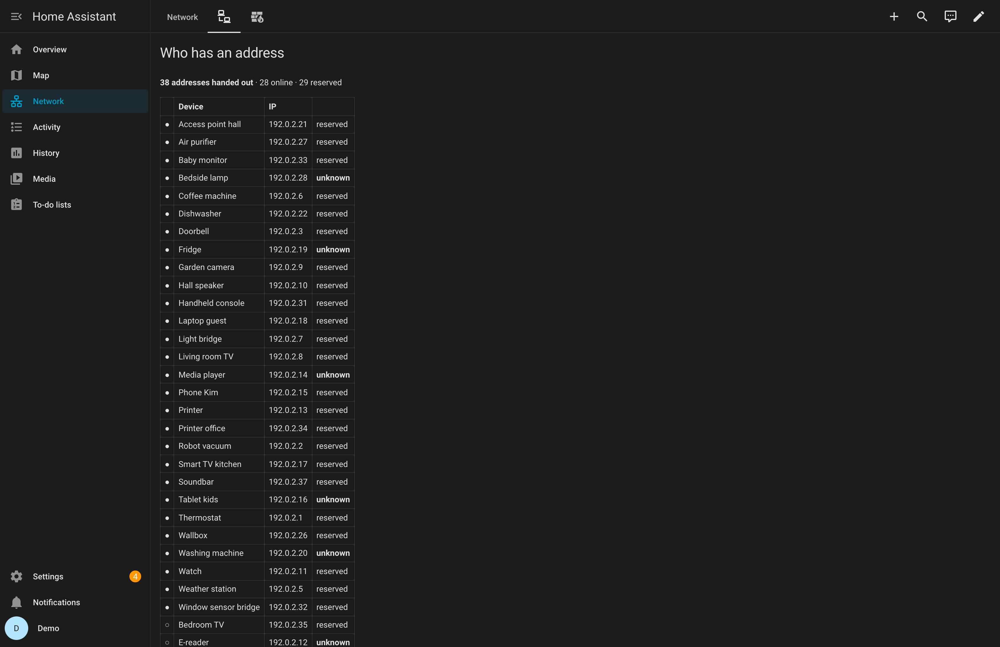
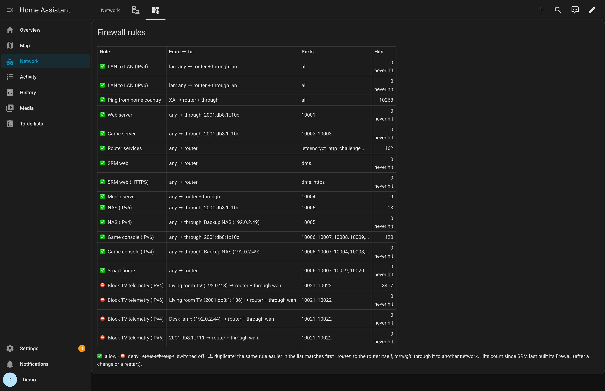
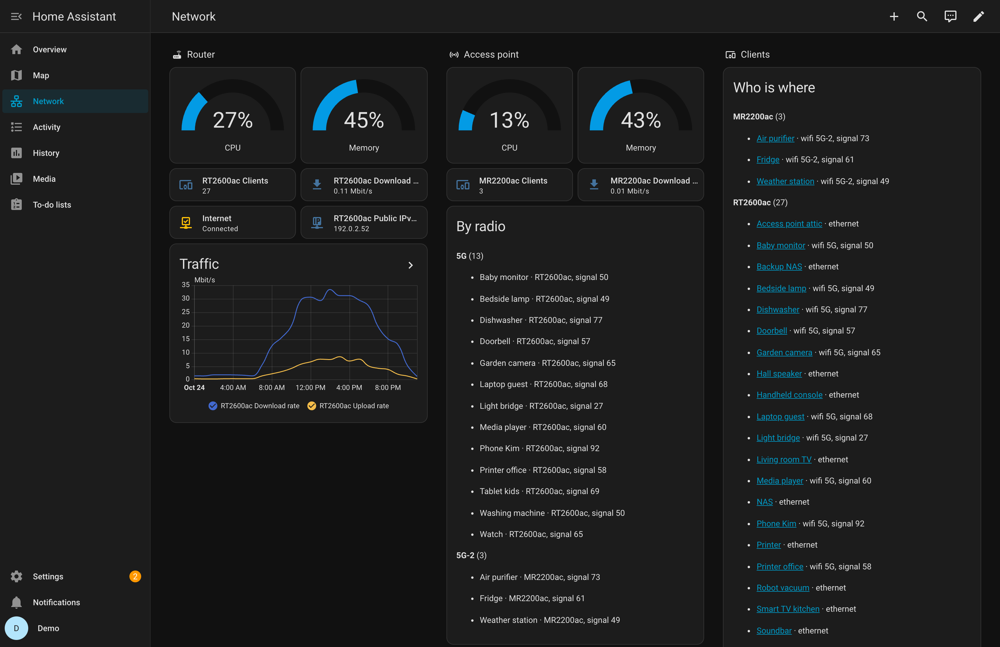

# Dashboards

The trackers carry where a client is (`connected_to`), how (`connection`) and on which radio
(`radio`, `signal`). A Markdown card turns that into lists, with nothing to install: add a card
of the type *Markdown* and paste one of the templates below as its content.

## Who is where

Every client at home, grouped by the router or access point it uses:

```jinja


**{{ g.grouper }}** ({{ g.list | count }})

- [{{ s.name }}](/history?entity_id={{ s.entity_id }}) · {{ s.attributes.connection }} {{ s.attributes.radio }}, signal {{ s.attributes.signal }}


```

Each name links to the client's history.

## By radio

Wi-Fi clients by band, with the device they use; useful to see what still uses 2.4 GHz:

```jinja


**{{ g.grouper }}** ({{ g.list | count }})

- {{ s.name }} · {{ s.attributes.connected_to }}, signal {{ s.attributes.signal }}


```

The radio names are SRM's: `2.4G`, `5G`, and `5G-2` for a second 5 GHz radio.

## Who has an address



Every IPv4 lease of the router, online devices first: reserved, unknown (neither reserved nor
named in SRM), or when the lease runs out. The template finds the router's *DHCP leases* sensor
by itself.

```jinja
--8<-- "docs/assets/cards/leases.jinja"
```

## Unknown devices

The question to ask now and then: who is this? Devices with an address that you have neither
reserved nor named in SRM:

```jinja
--8<-- "docs/assets/cards/unknown.jinja"
```

## Reservations to tidy up

Reservations whose device Home Assistant has not seen online for 30 days. Right after installing
the integration that is every reservation of a device that is offline; give it a month.

```jinja
--8<-- "docs/assets/cards/reservations.jinja"
```

## Firewall rules



The rule table in SRM's order: what a rule allows or blocks, from where to where, and how often
it matched. *never hit* and *duplicate* point to rules that do nothing.

```jinja
--8<-- "docs/assets/cards/firewall.jinja"
```

On a phone a table this wide does not fit. This one lists the same, two lines per rule:

```jinja
--8<-- "docs/assets/cards/firewall-list.jinja"
```

The example dashboard shows the table on wide screens and the list on narrow ones, with two
*Conditional* cards and a *Screen* condition (`(min-width: 900px)` and `(max-width: 899px)`).

Hits count since SRM last built its firewall, so they start again after a rule change or a
restart. For hits over time, switch on *Sensor per firewall rule* in the router's options and add
a *Statistics graph* card with the rules you care about, for example the blocking ones:

```yaml
type: statistics-graph
title: Blocked per hour
entities:
  - sensor.rt2600ac_firewall_hits_block_telemetry   # your rules' sensors
days_to_show: 1
period: hour
stat_types: [change]
chart_type: bar
```

## A complete dashboard



Router and access point with gauges, tiles and a traffic graph, the client lists above, and views for DHCP and the firewall.
[Download it](assets/example-dashboard.yaml) or copy it from here; the comment at the top says
where to paste it and which entity IDs to adjust.

```yaml
--8<-- "docs/assets/example-dashboard.yaml"
```
