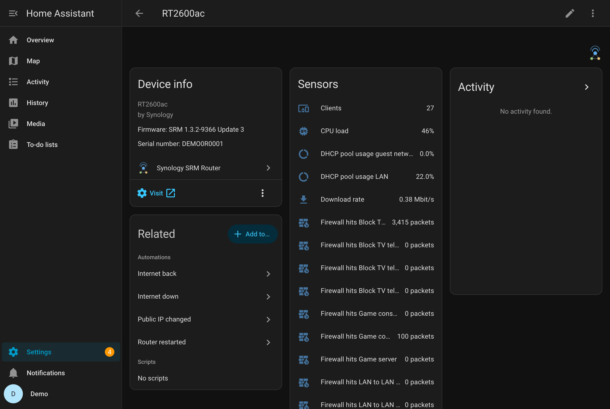

# Entities

## Every router and access point

| Entity | Unit | Notes |
| --- | --- | --- |
| CPU load | % | user, system and other load added up |
| Memory usage | % | |
| Download rate, Upload rate | Mbit/s (changeable per sensor) | the device's total traffic; measured against the kernel's counters |
| Clients | | online clients attached to this device, by Wi-Fi or cable |
| Last boot | timestamp | diagnostic |
| Load average (1, 5, 15 min) | | diagnostic, disabled by default |
| *volume* used, *volume* free space | %, GB | per USB volume, by its name in SRM; unavailable while the drive is not attached |
| *volume* size | GB | per USB volume; diagnostic, disabled by default |

Entities whose value the device's firmware does not offer are not created.

## Routers only

| Entity | Notes |
| --- | --- |
| WAN connection | connectivity |
| Public IPv4 address | the address the internet sees, as SRM last recorded it (can be out of date) |
| IPv6 address | the WAN interface's address, read live |
| WAN IPv4 address | the WAN interface's own address; diagnostic, disabled by default |
| WAN address type | public, private (another router in front) or carrier-grade NAT; diagnostic |
| Behind NAT | on when nothing on the internet can reach the router over IPv4 directly (port forwards will not work over IPv4); diagnostic |
| DHCP leases | IPv4 addresses the router has handed out and that are still valid |
| DHCP reservations | fixed IPv4 addresses set up in SRM; diagnostic |
| DHCP pool usage LAN, guest network | share of the pool's IPv4 addresses that are leased or reserved, per network; attributes `begin`, `end` |
| Firewall rules | how many rules SRM has; the attribute `config_hash` changes whenever a rule is added, removed, edited, switched on or off, or moved; diagnostic |
| Firewall hits *rule* | packets a rule matched since SRM last built its firewall (after a change or a restart the counter starts again; statistics handle that). Attributes: `enabled`, `action`, `ip_version`, `protocol`, `source`, `destination`, `ports`. Switched-off rules start disabled |

A firewall rule is recognised by what it does, not by its place in the list: moving or switching
it keeps its sensor; editing it gives it a new sensor, and the old one is removed. Rules with the
same name show their IP version, for example *Firewall hits Block (IPv4)*.

## Device trackers

See [Configuration](configuration.md#device-trackers).
