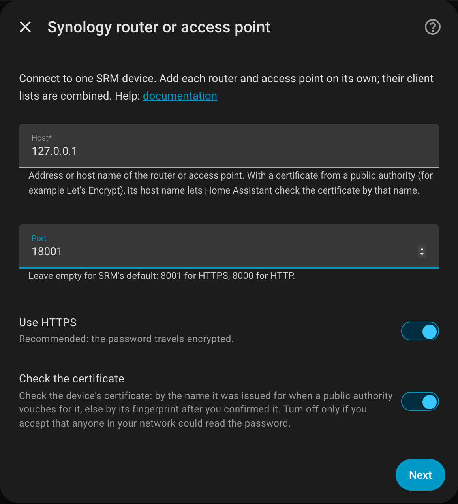

# Installation

Requires Home Assistant 2026.10.3 or newer. [HACS](https://hacs.xyz/) is the easy way; without
it, see [Without HACS](#without-hacs).

## In HACS

[](https://my.home-assistant.io/redirect/hacs_repository/?owner=eizedev&repository=ha-synology-srm-router&category=integration)

Or in HACS: the three dots, *Custom repositories*, add this URL with the type *Integration*:

```text
https://github.com/eizedev/ha-synology-srm-router
```

Install **Synology SRM Router**, then restart Home Assistant.

## Without HACS

1. Download `synology_srm_router.zip` from the
   [latest release](https://github.com/eizedev/ha-synology-srm-router/releases/latest).
2. Optional: check it. The release notes list its SHA-256, which `shasum -a 256
   synology_srm_router.zip` (macOS, Linux) or `Get-FileHash synology_srm_router.zip` (Windows)
   must show as well. With the [GitHub CLI](https://cli.github.com/),
   `gh attestation verify synology_srm_router.zip --repo eizedev/ha-synology-srm-router` also
   proves that this repository's release workflow built it.
3. Unpack it into `custom_components/synology_srm_router/` in your Home Assistant configuration
   folder (the folder with `configuration.yaml`), so that `manifest.json` ends up directly in it.
4. Restart Home Assistant.

To update, replace the folder's content with the new release's zip and restart. HACS users get
updates offered instead.

## Coming from the built-in Synology SRM integration

If your `configuration.yaml` has a `device_tracker` entry with `platform: synology_srm`, remove it
once this integration runs: the built-in tracker asks the router every 12 seconds.
[Details](configuration.md#coming-from-the-built-in-synology-srm-integration).

## Adding your devices

[](https://my.home-assistant.io/redirect/config_flow_start/?domain=synology_srm_router)

Add the integration once per router and per access point (the button above, or *Settings,
Devices & services, Add integration, Synology SRM Router*). Set up the router first: it keeps the
device trackers, also for the clients on its access points. An access point set up alone keeps
its own trackers; adding the router later moves them to the router, and the access point's
trackers are deleted with their history.

{ width="560" }

You need an SRM **administrator** account without two-factor authentication; a dedicated account
is best ([why](configuration.md#account)). Everything else is explained in
[Configuration](configuration.md).

## Updating

HACS shows new versions; install them and restart Home Assistant. What changed is in the
[changelog](https://github.com/eizedev/ha-synology-srm-router/blob/main/CHANGELOG.md).
